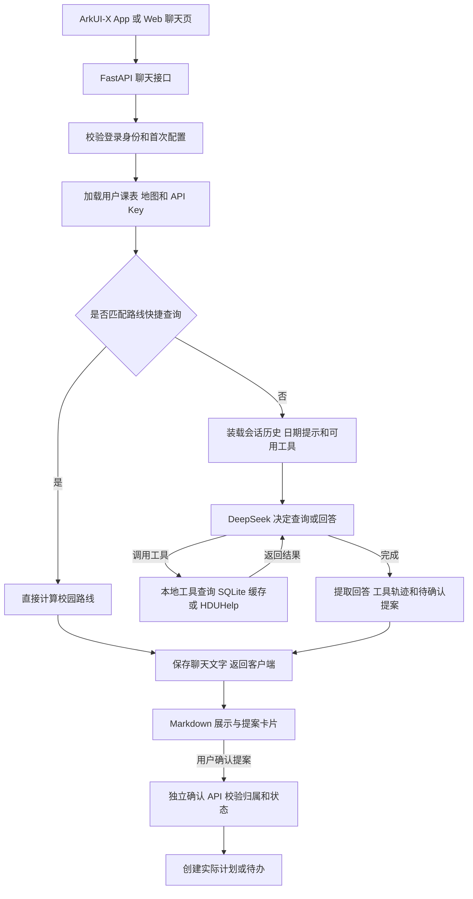

# CampusFlow Agent：RAG、MCP 与运行框架说明

整理日期：2026-10-14（Asia/Shanghai）。依据当前本地源码，包含已有本地修改。本文说明已实现的结构，并单独标记建议；没有新增运行能力。源码行号以本次检查时为准，后续可能变化。

## 1. 先理解当前项目

CampusFlow 当前是 **LangChain 工具调用型 Agent + 结构化校园数据查询 + SQLite 会话与业务持久化**。LangChain 的 `create_agent` 提供基于 LangGraph 的模型与工具循环。

- 已有检索增强路径：模型按需查询课程、通知、地点、HDUHelp 数据，再依据结果回答。
- 尚未建立面向校规、PDF、办事指南等文档的完整 RAG 流水线，没有发现文档分块、embedding、向量索引或重排实现。
- 尚未接入 MCP：当前工具是后端本地 Python 函数，部分函数通过普通 HTTP 调用 HDUHelp。
- 已有运行框架（harness）：提示词、身份隔离、工具筛选、历史装载、提案确认和当轮调用轨迹。
- 聊天记录持久化已实现；图执行断点恢复、历史摘要、显式整轮执行预算和增量返回尚未实现。

不要把 [architecture.md](architecture.md) 中的“后续演进”当成已完成能力，也不要把 Skill 目录里的能力描述等同于具体功能已经实现。

## 2. 四个概念分别负责什么

| 概念 | 用校园助手理解 | 在本项目中的位置 |
| --- | --- | --- |
| LLM / 模型 | 理解问题、选择工具、组织答案的“大脑” | `ChatOpenAI` 对接 DeepSeek 兼容接口；聊天支持代码中配置的 `deepseek-v4-pro`、`deepseek-flash` |
| RAG / 检索增强生成 | 回答前查资料，让答案有外部依据 | 已有工具查询结构化数据；文档知识库检索尚未实现 |
| MCP / Model Context Protocol | AI 应用连接外部工具与上下文服务的一套标准协议 | 当前未接入；HDUHelp REST 和本地 `@tool` 不自动构成 MCP |
| Harness / 运行框架 | 给模型准备上下文、限制可用工具、控制执行和处理结果的整套环境 | `api.py`、`agent.py`、`tools.py`、`skills.py`、数据层及确认流程共同组成 |

RAG 关注“查什么信息、怎样据此回答”，MCP 关注“怎样连接外部能力”。RAG 可以直接查 SQL 或 API，不要求先建立向量库，也不要求使用 MCP；MCP 可以承载检索工具，也可以承载日历等其他工具。[LangChain Retrieval](https://docs.langchain.com/oss/python/deepagents/retrieval)、[MCP 官方架构](https://modelcontextprotocol.io/docs/2026-07-28/learn/architecture)。

Harness 的核心是把模型、提示词、工具和执行控制组织起来。项目目前直接配置 `create_agent(model, tools, system_prompt)`，没有配置自定义 Agent middleware；FastAPI 的 HTTP middleware 属于另一层。[LangChain Agents](https://docs.langchain.com/oss/python/langchain/agents)。

## 3. 一次聊天实际怎样运行



关键过程：

1. 客户端调用 `POST /api/v1/chat`。后端从登录会话确定 `user_id`，客户端提供 `session_id`、模型和消息，不能用聊天参数指定其他用户身份。
2. 后端将用户确认过的课表、地图加载到按用户隔离的 Store 上下文。它们没有全部拼进 system prompt，模型通过工具按需读取。
3. 部分“从 A 到 B 怎么走”的消息可以走确定性路线快捷路径，直接计算路线，不调用 LLM。快捷路径仍检查相关工具是否可用。
4. 普通聊天每轮重新创建模型对象和 Agent 图。读取当前用户、当前会话的全部历史，转换为 `HumanMessage` / `AIMessage`，加入本次问题。
5. System prompt 提供角色、工具使用要求及上海时区的当前日期、本周范围等信息。模型决定是否调用工具；工具结果返回后，模型可以继续查询或生成答案。
6. 回合结束后返回 `message`、`tool_traces`、`pending_actions`。回答文字进入聊天历史，提案另存业务表。
7. 提案工具会保存“待确认提案”，但实际计划、待办要通过用户确认后的独立接口写入。

源码入口：[api.py](../agent-service/src/campusflow_agent/api.py) 第 100、239、942 行；[agent.py](../agent-service/src/campusflow_agent/agent.py) 第 86、111、147、195、266 行；[tools.py](../agent-service/src/campusflow_agent/tools.py) 第 24、58 行。

上一项 Markdown 修改位于客户端显示层：它改善第 7 个节点的回答展示，没有改变模型、检索、工具或会话记忆结构。

## 4. 当前“RAG”究竟查什么

### 数据来源和新鲜度

| 数据 | 实际来源 / 导入方式 | 回答时如何读取 | 当前边界 |
| --- | --- | --- | --- |
| 个人课程与已有事务 | 用户确认的课表、ICS 订阅同步；实际待办在业务表 | `get_schedule` 按日期或日期范围读取、合并 | 保存或手动同步订阅时获取 ICS；没有发现定时后台同步 |
| 校园地点、通知 | 源码内置的下沙校区数据包初始化写入 SQLite；地点查询还合并用户确认地点 | 名称、别名、类别等子串匹配 | 没有语义召回、分词排序、向量检索；通知工具默认未过滤有效期 |
| 校园路线 | 固定校园路线图和步行边权 | `plan_campus_route` 做最短路径计算 | 用户图片导入地点不等于导入完整道路网络 |
| 天气 | Store 中的演示结果 | `get_weather` 读取固定示例 | 尚未接入实时天气服务 |
| 学籍、成绩、考试、校园卡、图书馆等 | 用户授权后显式同步的 HDUHelp 资源；加密保存于 SQLite | 解密缓存，按资源整包返回，包含 `synced_at` | 没有缓存 TTL 校验；部分同步失败时旧缓存可能保留 |
| 空闲教室、教室占用、寝室电费 | 当前用户已连接的 HDUHelp 服务 | 工具通过 HTTP 实时查询 | 受授权范围、外部服务和请求超时影响 |
| 课表 / 地图图片 | Flash 视觉解析生成候选 JSON，Pydantic 校验，用户确认 | 确认后的结构化数据供工具查询 | 不是图片向量库，也不是 PDF 文档索引 |

对应源码：[store.py](../agent-service/src/campusflow_agent/store.py) 第 149、172、224、232、235 行；[campus_data.py](../agent-service/src/campusflow_agent/campus_data.py) 第 23、362、513、576、695 行；[accounts.py](../agent-service/src/campusflow_agent/accounts.py) 第 344、672 行；[vision.py](../agent-service/src/campusflow_agent/vision.py) 第 45 行；[schedule_subscription.py](../agent-service/src/campusflow_agent/schedule_subscription.py) 第 81 行。

### 可以称作哪种检索增强

例如用户问“明天有哪些课”，模型选择 `get_schedule`，得到课程列表，再整理成回答。这符合广义的 **Agentic RAG**：Agent 决定什么时候检索、用哪个查询工具。当前项目更准确的表述是“工具驱动的结构化数据检索增强”。[LangChain Retrieval](https://docs.langchain.com/oss/python/deepagents/retrieval)。

典型文档 RAG 的下面这些步骤目前尚未实现：

```text
资料导入 → 清洗与分块 → 建立检索索引
用户问题 → 相关片段检索 → 用户/校园/有效期过滤 → 可选重排
         → 把证据交给模型 → 带来源的回答
```

索引可以先用关键词检索，再根据效果引入 embedding 和向量检索。向量库只是一个可选部件。当前通知查询并没有搜索整份校园网站，也没有自动联网收集新通知；它只查询已有数据包。

三个适合区分的例子：

- “明天下午有哪些空教室？”：优先实时业务 API，因为状态随时间变化。
- “奖学金申请需要什么材料？”：适合校方政策、办事指南的文档 RAG，并引用版本和来源。
- “帮我安排下周复习计划”：查询课程与事务后规划，再经提案确认；RAG 只负责提供依据，任务校验和写入由业务代码负责。

## 5. 当前有哪些工具和 Skills

### 13 个本地工具

| 分组 | 工具名 | 作用 |
| --- | --- | --- |
| 课程 | `get_schedule` | 按日期查课程与事务 |
| 校园信息 | `get_weather`、`search_campus_notices` | 演示天气、现有通知关键词查询 |
| 地点与路线 | `find_campus_places`、`plan_campus_route` | 地点匹配、校园步行路线 |
| HDUHelp 缓存 | `get_hduhelp_profile`、`get_hduhelp_academics`、`get_hduhelp_campus_life` | 本人已同步资源 |
| HDUHelp 实时 | `get_unused_classrooms`、`get_classroom_usage`、`get_electricity_balance` | 教室和电费查询 |
| 提案 | `propose_task_change`、`propose_plan` | 保存待确认的单任务或完整计划提案 |

定义和筛选位于 [tools.py](../agent-service/src/campusflow_agent/tools.py) 第 58、336 行。普通聊天没有额外的通用网页搜索、文件系统、代码执行工具，也没有项目自定义的多 Agent 调度。

### Skills 是工具治理目录

当前固定目录有五个 Skill：课表规划师、校园地点助手、DDL 守望者、学习复盘助手、HDUHelp 校园档案。安装操作保存版本、已同意的权限与启停状态，不会加载 `SKILL.md`、动态插件代码或 MCP server，也没有把每个 Skill 的说明单独注入提示词。

实际可用工具可以理解为：

```text
核心天气/通知工具
+ 已安装且启用的 Skill 所映射工具
+ 当前账户课表、地图、已同步资源、已连接服务所授予的只读工具
= 本轮传给模型的工具集合
```

所以禁用某个 Skill，不一定让相关只读查询消失：已经确认课表或同步数据的账户仍可能通过数据分支获得相应工具。这个集合在每轮建图时计算。

“学习复盘助手”虽在目录中声明了复盘能力，但目前没有它对应的专用工具映射，不能据此认为已经有自动周报、跨会话检索或完整复盘工作流。目录和映射位于 [skills.py](../agent-service/src/campusflow_agent/skills.py) 第 13、140、251、351 行；数据分支位于 [agent.py](../agent-service/src/campusflow_agent/agent.py) 第 147 行。

## 6. 记忆：保存了什么，没保存什么

| 层次 | 当前做法 | 对后续优化的含义 |
| --- | --- | --- |
| 聊天历史 | SQLite 保存 `user` / `assistant` 文字，按用户和会话读取全部历史 | 可以重启后继续聊，但长会话会持续增加上下文；没有摘要或 token 裁剪 |
| 当轮工具上下文 | 图运行期间包含工具调用与 `ToolMessage` | 通用工具参数、结果与调用轨迹没有作为下一轮聊天历史恢复 |
| 业务持久状态 | 保存课表、地图、授权资源、任务、计划、提案、Skill 状态 | 业务数据可以跨会话存在，模型仍需要通过工具读取 |
| 图执行状态 | `create_agent` 没配置 checkpointer；`ainvoke` 没传 `thread_id` | 没有应用配置的步骤级断点恢复或中途暂停后继续执行 |
| 长期个人记忆 | 未发现自动提取偏好/事实、冲突更新、跨会话按需召回流程 | “聊天记录存在硬盘”不等于“模型有可管理的长期记忆” |

例如，上一轮查出的校园卡余额可能以回答文字留在历史里；工具原始结果不随历史恢复。下一轮应再次读取资源并核对 `synced_at`；现有校园卡工具仍读取缓存，不会自动刷新。用户要求当前余额时，应先刷新缓存或后续接入实时读取，不能把旧回答当成最新事实。

`CampusStore` 是项目自己的业务 Store，不等于已经接入 LangGraph 的长期记忆 store。应用层提案确认也不等于 LangGraph 的 interrupt/checkpoint 工作流。LangGraph checkpointer 保存线程的图状态，长期 store 保存跨线程的应用数据；两者解决不同问题。[LangGraph Persistence](https://docs.langchain.com/oss/python/langgraph/persistence)。

源码：[store.py](../agent-service/src/campusflow_agent/store.py) 第 66、81、656 行；[agent.py](../agent-service/src/campusflow_agent/agent.py) 第 130、217、229、245、322 行。

## 7. Harness 的执行控制和权限边界

### 已有的控制

- 登录身份由后端确定；工具通过 `ContextVar` 取得当前用户，模型工具参数里没有可任意切换的 `user_id`。
- 只把本轮允许的工具传给模型；工具入参由类型和业务规则约束。
- 课表日期范围最多 32 天；教室查询 `limit` 被限制到 1–50；单任务工具校验 action、起止顺序和提醒范围。
- 提案与实际任务分开。确认接口检查当前用户归属和 `pending` 状态，模型没有这个确认工具。
- 调用失败或收到取消异常时，`ainvoke` 的异常处理补写一条失败结束消息；身份上下文在 `finally` 重置。

### 提示词要求与硬约束的区别

“规划前检查冲突”“只有明确要求创建时才提案”“每个任务必须有时间和提醒”等目前主要是 system prompt 里的行为要求。代码会收集并返回 `conflicts`，但不会因为存在冲突自动拒绝提案。

计划任务的时间、提醒等字段目前仍可为空；计划提案最多处理前 8 个里程碑、每个前 12 项任务。确认时不会重新计算冲突或检查 Skill 开关。后续若要保证某项规划规则，应在业务层补校验，不能只增加提示词。

另一个需要单独验证和完善的源码边界：`propose_task_change` 接受 `create/update/delete`，但 `confirm_proposal` 的实际应用分支目前处理完整计划和 `action=create`，没有对应的单任务 update/delete 执行分支。不能把“能生成修改/删除提案”视作“能完成修改/删除任务”。本次仅静态识别，没有执行该场景或修改实现。

源码：[tools.py](../agent-service/src/campusflow_agent/tools.py) 第 27（`PlanTaskInput`）、81、187、280 行；[store.py](../agent-service/src/campusflow_agent/store.py) 第 284、339、419、499 行；[api.py](../agent-service/src/campusflow_agent/api.py) 第 1076 行。

### 超时、重试、取消与展示

| 项目 | 当前行为 | 实际影响 |
| --- | --- | --- |
| 模型超时 | 默认 90 秒传给模型 HTTP 请求 | 是单次请求超时配置，不是整个 Agent 回合的 90 秒总预算 |
| 重试 | 模型设置 `max_retries=2` | 符合重试条件的单次模型请求最多重试两次；不是整轮重新执行 |
| 整轮预算 | 未显式设置整体 deadline、模型/工具调用次数、token 或成本预算 | 多次模型调用、工具调用和重试可使总耗时超过 90 秒；框架自身限制不能替代产品预算 |
| 原生请求等待 | 连接超时 12 秒，读取超时 90 秒 | 客户端可能先结束等待；不代表服务端任务必然同步停止 |
| 取消 | 有取消提案接口；没有专用取消运行接口、后台 job 状态机或客户端断连监控 | 取消提案、切页、停止界面轮询都不等于取消模型运行 |
| 返回方式 | `ainvoke` 完成后一次性 JSON 返回 | 未实现 SSE / WebSocket 流式文字或增量工具事件 |
| 工具轨迹 | 回合结束后提取工具 ID、名称、参数、结果 | 不是持续记录的完整执行日志，也没有通用耗时、token、成本字段 |
| Web 显示 | 当轮显示工具轨迹；恢复历史只恢复聊天文字 | 刷新后无法从聊天历史还原完整工具执行过程 |
| 原生显示 | `ChatResponse` 未声明 `tool_traces`，聊天页主要使用回答和提案 | 暂未提供通用工具轨迹展示 |
| Skill 审计 | 记录安装、启停及部分启用 Skill 的工具名 | 不等于所有工具的完整运行审计 |

代码入口：[config.py](../agent-service/src/campusflow_agent/config.py) 第 23、36 行；[agent.py](../agent-service/src/campusflow_agent/agent.py) 第 126、229、232、322 行；[CampusFlowApi.ets](../arkui-x-client/entry/src/main/ets/services/CampusFlowApi.ets) 第 96 行；[ApiModels.ets](../arkui-x-client/entry/src/main/ets/model/ApiModels.ets) 第 82 行；[app.js](../agent-service/src/campusflow_agent/web/app.js) 第 1378、1499 行。

`.env.example` 留有 LangSmith tracing 配置占位，但仅据此不能证明本地已经启用。本次没有读取真实 `.env`。仓库已有 API、Store、工具及集成测试；这些测试的存在也不等于已具备回答质量、召回率或成本评测。本次文档整理未重跑测试。

## 8. MCP 当前在哪里，以及以后怎么接

**当前没有 MCP 层。** 调用关系是：

```text
App / Web ─普通 HTTP→ FastAPI
Agent ─LangChain 本地调用→ @tool Python 函数
部分工具 ─普通 HTTP→ HDUHelp REST API
```

MCP 的三个角色是 host（协调能力的 AI 应用）、client（host 内连接服务的组件）、server（提供工具、资源和提示模板的服务）。协议使用 JSON-RPC，可通过 stdio 或 Streamable HTTP 等方式传输。MCP 不负责替代模型的思考，也不自动建立知识库、记忆或权限业务规则。[MCP 官方架构](https://modelcontextprotocol.io/docs/2026-07-28/learn/architecture)。

未来如果需要接入外部 MCP server，一种可能的改造位置是：

```text
CampusFlow 后端中的 MCP client
    → 连接允许的 MCP server
    → 将允许的能力适配为 Agent 工具
    → 合并到本轮工具集合
    → 保留用户身份、授权、预算和提案确认规则
```

这只是后续方案。后端也可以把校园通知检索封装为 MCP server，供多个 AI 应用复用。仅为现有 13 个本地工具增加协议层，不会自然提高回答质量；当需要跨应用共享能力或连接已有外部 MCP 服务时，再引入更有针对性。

## 9. 后续优化建议：按要解决的问题推进

以下是依据当前源码提出的建议，均尚未实施。无需一次性完成。

| 建议顺序 | 先解决的问题 | 建议改动 | 如何判断有效 |
| --- | --- | --- | --- |
| 1. 数据可信度和业务闭环 | 缓存过期、演示数据混用、提案能力与落地不一致 | 统一工具结果来源/更新时间/演示标记；通知有效期与 HDU 缓存刷新策略；补齐提案操作和确认时校验 | 固定测试题能指出来源与时间；过期数据和失败有清楚提示；提案落地结果可核验 |
| 2. 执行控制与观测 | 等待时间不可控、失败难定位 | 整轮 deadline、调用次数预算、取消/运行状态；持久化脱敏 trace、耗时及用量；设计客户端等待和结果恢复策略 | 能定位慢在模型还是工具；超时后有确定状态；重复确认或重试不会产生重复任务 |
| 3. 上下文与记忆 | 全量历史及整包资源造成输入增长 | 近期历史 + 可更新摘要 + 必要工具证据；按字段/时间筛选资源；有中断恢复需求再引入 checkpointer | 长对话仍能记住约束，输入规模受控；能够区分历史信息和最新查询结果 |
| 4. 文档 RAG | 校规和办事指南没有可靠查询渠道 | 导入权威文档，维护来源、版本、有效期、校园/用户过滤；先做关键词基线，再按测评决定向量、混合检索和重排 | 在固定问题集上查到正确条款、引用正确版本；找不到证据时说明不足 |
| 5. MCP 互联 | 需要已有外部服务或跨应用复用 | MCP client / adapter 或校园能力 server；继续使用工具允许名单、身份隔离和确认规则 | 外部能力可发现、可控、可追踪，异常不会拖住整轮聊天 |

优化前建议准备一组固定问题，记录正确数据、应该调用的工具、是否应该产生提案、预期来源和最大等待时间。优先覆盖：“明天的课程”“当前电费”“过期通知”“下周计划与课程冲突”“未授权数据”“修改/删除已有待办”“长对话中仍记住时间约束”。这样可以比较优化前后效果，而不是只凭单次聊天感觉判断。

如果准备做第二项代码改动，数据来源与新鲜度、整轮执行控制、上下文预算都比直接更换向量数据库或增加 MCP 更接近当前已发现的问题。

## 10. 继续读代码的入口

| 想优化什么 | 优先阅读 |
| --- | --- |
| 模型、提示词、会话循环、工具权限 | [agent.py](../agent-service/src/campusflow_agent/agent.py) |
| 工具 schema、工具结果、外部查询 | [tools.py](../agent-service/src/campusflow_agent/tools.py)、[hduhelp_access.py](../agent-service/src/campusflow_agent/hduhelp_access.py) |
| Skills 的安装、启停和工具映射 | [skills.py](../agent-service/src/campusflow_agent/skills.py) |
| 历史、冲突、提案、实际任务写入 | [store.py](../agent-service/src/campusflow_agent/store.py) |
| 校园地点、通知及路线检索 | [campus_data.py](../agent-service/src/campusflow_agent/campus_data.py) |
| 账户上下文、授权资源、缓存 | [accounts.py](../agent-service/src/campusflow_agent/accounts.py)、[api.py](../agent-service/src/campusflow_agent/api.py) |
| 图片和课表订阅导入 | [vision.py](../agent-service/src/campusflow_agent/vision.py)、[schedule_subscription.py](../agent-service/src/campusflow_agent/schedule_subscription.py) |
| App 等待、对话和结果显示 | [CampusFlowApi.ets](../arkui-x-client/entry/src/main/ets/services/CampusFlowApi.ets)、[AgentPage.ets](../arkui-x-client/entry/src/main/ets/pages/AgentPage.ets) |

本次范围：源码与官方概念文档核对。未读取真实 API Key、`.env` 或个人数据库，未调用模型和 HDUHelp 实时服务；静态发现的行为边界需要在后续对应修改任务中补充场景验证。
