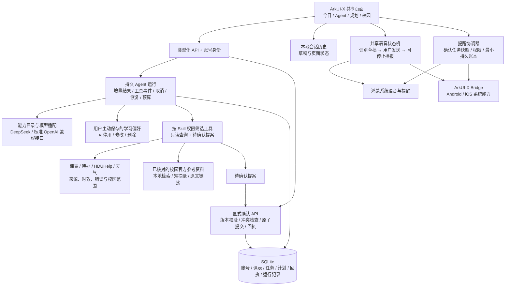

# CampusFlow 架构（截至第十六阶段）

一套 ArkUI-X/ArkTS 页面与业务逻辑服务鸿蒙、Android、iOS；平台适配器只处理语音、通知及平台差异。本图描述已实现源码，不代表三端已经编译或在设备运行。

## 一次可执行安排

1. 用户输入文字，或将语音识别为可修改的文字后主动发送。共享客户端创建稳定运行 ID；重试同一操作不会新建重复运行。
2. 服务端根据账号载入会话与明确启用的偏好，核对所选模型声明的工具/流式能力和对应凭据。额外供应商只使用服务端明确配置的密钥，不接收个人 DeepSeek 密钥。
3. Agent 在轮次、时间与工具预算内读取课表、待办、已授权校园数据等；工具进度来自真实事件，私人推理不作为进度展示。没有/过期资料、失败、静态参考和实时结果分别说明。
4. 模型只生成提案。用户确认时重新校验版本、有效期、课程与任务冲突，整笔写入和回执在同一事务提交；重复确认返回同一结果。
5. 客户端更新今日/规划，提醒协调器读取完整已确认任务快照后调用系统适配器。网络或不完整快照不能当成清空指令。系统受理与实际送达是两种状态。
6. 断线后可查询原运行结果；会话历史还可在本地回看。取消、退出、换账号与后台回调按作用域和代次隔离。

## 数据和能力边界

- SQLite 保存账户、登录会话、结构化课表、计划/任务、用户级 Skill、运行/事件、确认回执与主动填写的偏好；客户端本地历史另有账号作用域。数据库类型本身不代表生产级恢复已验收。
- 个人模型密钥、HDUHelp 令牌与课表订阅凭据使用现有 Fernet 加密路径；个人数据按登录身份读取。额外供应商凭据仅取已配置环境变量，不随模型目录返回。
- 课表和地图图片仅供当次解析，候选数据需用户确认；导入图片/工具结果/校园原文都是数据，不能作为行为指令。
- 天气是所标城市级预报；地图与路线为参考估算，未知开放状态不写成关闭。正常账号不以演示课表/公告填补缺失。HDUHelp 仅使用已授权资源。
- 知识检索是 4 条经核对官方页面的本地词法匹配，无向量库和模型调用成本。返回原文标题、小节、短摘录、链接和核对日期；无命中不表示学校没有规定，不代替实时查询。
- 偏好只含明确填写的枚举和数值，默认关闭；不推断私密习惯。关闭/删除作用于后续请求，不撤回已开始的运行或旧回答。
- 原生编译、签名、设备权限、真实模型完整对话及语音/提醒送达均没有由本轮离线测试证明。第十七阶段工程专项与真实模型评测按用户要求未开展。

详细契约与验收见 [阶段总表](roadmap-9-16.md)、[运行](stage-13-agent-runtime.md)、[数据依据](stage-14-data-evidence.md)、[跨端能力](stage-15-native-capabilities.md)、[模型/偏好/知识](stage-16-selected-enhancements.md)。
