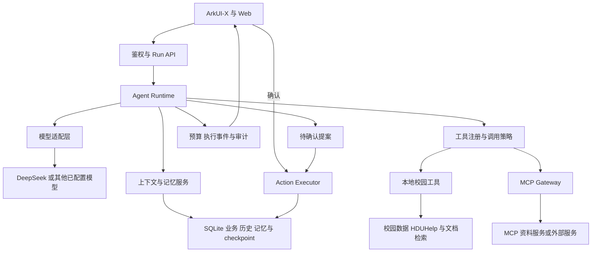

# CampusFlow 完整 Agent 体系改进方案

方案日期：2026-10-14（Asia/Shanghai）。依据当前本地项目和本次核对的官方接口。本文是待实施方案；本次只新增文档，没有安装依赖或修改运行代码。

## 1. 目标和完成标准

建议沿用 FastAPI、LangChain/LangGraph、ArkUI-X 和现有校园工具，逐步形成以下闭环：

```text
理解目标 → 准备上下文 → 制定步骤 → 检索/调用工具
        → 校验结果 → 必要时用户确认 → 执行业务操作
        → 回答与来源 → 保存可管理的记忆和执行证据
```

这里的“完整”以可验收能力定义：

| 模块 | 完成后应具备的能力 |
| --- | --- |
| 模型适配 | 按配置切换模型；兼容工具调用、结构化输出、流式事件；能力不足时明确处理 |
| Agent Runtime / harness | 统一运行身份、状态、预算、取消、错误、执行记录与恢复策略 |
| 工具和 Skills | 本地与 MCP 工具统一注册、授权、参数校验；Skills 有版本化操作说明和依赖工具 |
| 记忆 | 受控上下文、持久 checkpoint、可查看修改删除的用户事实、可检索的任务经历 |
| 检索与 RAG | 业务数据按需查询；文档可导入、更新、检索、引用和按范围隔离 |
| MCP | 实际连接服务、发现能力、调用工具；管理认证、连接生命周期和错误 |
| 业务执行 | 创建、修改、删除目标明确；确认、事务、幂等和冲突校验完整 |
| 客户端与评测 | 显示运行状态、工具进度、来源和确认卡片；用固定用例验证可靠性 |

采用一个受控的主 Agent 作为首期实现。复杂任务可以先用结构化步骤和领域工具完成；有明确的独立子任务和评测收益后，再增加检索或规划子 Agent。后续扩展复用同一身份、预算与工具策略。

当前能力和缺口见 [agent-runtime-architecture.md](agent-runtime-architecture.md)。下述模块名、API、数据表和参数都是建议设计，不表示仓库中已经存在。

## 2. 目标架构



| 建议模块 | 职责和最小契约 |
| --- | --- |
| `ModelCatalog / ModelGateway` | 解析模型配置、用户凭据和能力，提供统一模型对象 |
| `AgentExecutor` | 封装 `create_agent` 及未来的图工作流，执行版本化 Agent 配置 |
| `RunService / RunRepository` | `start/get/cancel/events`；管理运行身份、状态、结果和重复请求 |
| `ContextBuilder / MemoryService` | 组合本轮上下文，管理摘要、事实、经历和 checkpoint |
| `ToolRegistry / ToolPolicy` | 注册本地与 MCP 工具；发现和执行时校验权限、参数和预算 |
| `MCPGateway` | 封装 MCP SDK/适配器差异、认证、发现、调用、资源与提示模板读取 |
| `EvidenceRepository / KnowledgeService` | 保存查询证据，管理资料版本、检索与引用 |
| `ProposalService / ActionExecutor` | 提案、确认、目标版本校验、幂等写入和业务事务 |

API、校园业务和客户端只依赖这些契约。提供方参数、MCP 协议细节与存储实现留在各自模块中。

## 3. 模型适配层

### 配置与接口

模型配置至少包含：`profile_id`、`provider`、实际 `model`、连接配置引用、凭据引用、角色、能力、上下文上限、输出限制、超时与重试策略。

建议设置 `chat_agent`、`summary`、`vision`、`embedding` 等角色；角色可以复用同一模型配置。embedding 独立配置，不能假设聊天模型提供 embedding 接口。

首期适配以现有 DeepSeek 路径为基线，再加入一个经过验证的 OpenAI-compatible 接口。若后续需要其他原生协议或本地模型，增加对应 provider adapter。第二个真实服务选择用户已有的云端或已部署本地服务，不预设本机具备运行大模型的硬件与环境。

建议以 LangChain 的标准消息和 `BaseChatModel` 为内部接口，提供 `build_chat(profile, credential)`，复用现有 `invoke/stream` 能力；视觉调用也从模型目录取配置，移除独立写死的模型名。提供方差异由 adapter 处理。[LangChain Models](https://docs.langchain.com/oss/python/langchain/models)。

### 必须处理的差异

- 能力按具体模型配置声明：工具调用、并行调用、流式、视觉、结构化输出和 reasoning，不能仅凭接口地址兼容就认定全部支持。
- DeepSeek 的 `thinking` 等专有参数只由对应 adapter 发送。
- 统一正文、`ToolCall{id,name,arguments}`、结束原因、用量和错误分类；保留工具调用与结果的 ID 配对。
- 流式工具参数完整组装、解析和校验后才能执行。不能把参数碎片交给业务工具。
- 提供方要求续接的专用字段保留在受限执行状态中，不作为用户可见记忆或日志。模型切换时做兼容转换或建立新执行状态。
- 用量缺失标记为未知；成本先记录估算来源，不把未知写成零。
- 重试只覆盖允许重试的网络/服务失败，记录每次 attempt，并计入整轮预算；模型再次推理与 HTTP 重试分别计数。
- fallback 明确配置和记录；不重复回放已执行业务动作，视觉模型能力缺失时给出可恢复错误。

新增按用户、provider 隔离的加密凭据记录。迁移时把现有 DeepSeek 凭据作为旧配置来源；密钥不进入 prompt、checkpoint 消息、工具参数或 Git。

后端提供模型目录接口，客户端按目录显示可用模型。兼容旧 `deepseek-v4-pro` / `deepseek-flash` 别名和会话记录，逐步解除 `schemas.py`、`agent.py`、视觉服务和 App 按钮中的两模型限制。

验收分两层：模拟 adapter 验证错误、能力与 tool-call 契约；真实服务验证连通、工具调用、结构化输出及需要的流式能力。未进行真实第二提供方验证时，只报告接口和契约完成。

## 4. Agent Runtime、工具治理与业务执行

### 每次执行都是可查询的 run

`RunContext` 由后端认证结果构造，包含 `user_id/session_id/run_id/model_profile`、校园、时区、权限版本和配置版本。工具通过框架隐藏注入的运行上下文读取身份，不让模型指定数据所有者。逐步替代当前以 `ContextVar` 为主要工具契约的实现。[LangChain Tools](https://docs.langchain.com/oss/python/langchain/tools)。

建议状态：`queued → running → completed / failed / cancelled / timed_out / interrupted`。明确区分三件事：

- 运行结束并返回待确认提案：run 可以已经 `completed`，提案仍为 `pending`。
- 取消提案：只改变提案，不取消其他运行。
- 需要确认后继续同一图：另外实现 `waiting_confirmation`、checkpoint 和受控恢复，不能只增加一个状态名称。

建议新增 `POST /api/v1/runs`、`GET /api/v1/runs/{id}`、`POST /api/v1/runs/{id}/cancel`、`GET /api/v1/runs/{id}/events`。按用户限定 `client_request_id` 的唯一性，重复发送返回同一个 run。现有 `/chat` 可先作为兼容入口调用同一 Runtime。

本地先采用单进程运行服务、内存 task 注册表及 SQLite 持久状态。进程重启后把无法自动恢复的运行标记为 `interrupted`，在完成 checkpoint 恢复机制前不声称可以续跑。多进程部署以后再增加共享队列、worker lease 与跨进程取消。

### 预算、事件和权限

- 加入整轮 deadline、模型调用数、请求 attempt 数、工具调用数、并发数及输入/输出预算。可先试验整轮 180 秒、单次模型 60 秒、6 次模型调用、12 次工具调用、3 个并发只读工具；这些是待基线测量调整的初值。
- 每次调用前检查剩余预算，超时和取消后停止安排新工具。正在运行的外部请求与同步工具需自己的时限；取消本地任务不保证外部服务已撤销动作。
- 工具注册项包含 schema、来源、版本、读写性质、权限、超时和结果大小上限。用 `wrap_tool_call` 等统一入口处理执行校验、审计与错误，不只在发现工具时做一次筛选。
- 将数据授权、工具启停和 Skill 工作流启停分开建模；显式工具禁用优先于自动数据授予，界面说明实际范围。保留无需安装 Skill 的基础数据查询路径。
- Skills 增加版本化操作说明、输入/输出约定、所需工具、权限与验收用例。只加载本轮需要且启用的说明，不把目录能力名称当成已经实现的工作流。
- 工具结果统一成状态、受控数据、来源时间、证据 ID 和错误；原始结果按保留策略保存，避免整包敏感资源进入通用日志。

事件采用项目自己的格式：`event_id/run_id/seq/type/time/payload`，包括开始、回答增量、工具开始/结束、提案、完成和失败。保存事件后再投递，客户端按序号去重和恢复。SSE 展示答案与工具进度，模型内部 reasoning 不作为展示事件。

LangChain 已提供模型/工具调用限制及摘要 middleware，可作为基础；整轮 deadline、用户策略和事务仍由项目负责。[官方 middleware](https://docs.langchain.com/oss/python/langchain/middleware/built-in)。流式输出先转换为项目事件，避免客户端依赖框架原始事件格式。[官方 Streaming](https://docs.langchain.com/oss/python/langchain/streaming)。

### 写入闭环先保证正确

提案绑定 `user_id/run_id/tool_call_id`，携带操作、目标 ID、目标版本、payload 和有效期。update/delete 必须指定目标 ID，不能仅凭标题定位。补齐目前确认分支缺少的修改/删除执行。

确认时重新核验归属、权限、目标版本和必要业务约束。冲突属于允许用户接受还是必须阻止的规则要显式定义。实际写入、提案状态与操作结果在一个事务中完成；重复或并发确认返回同一结果和实际任务 ID。

用唯一幂等键限制同一次工具调用产生的提案和实际动作。取消与提交竞争时，显示是否已经产生业务效果。未来 MCP 写工具也纳入这个执行边界；不能仅信任外部服务器声明的“只读”标记。

## 5. 记忆系统：四层分别管理

| 层次 | 内容 | 首期实现与边界 |
| --- | --- | --- |
| Working memory：当前上下文 | 当前任务、约束、近期完整回合、摘要、相关事实及工具证据 | 每次模型调用重新组合，受模型上下文预算约束 |
| Checkpoint：执行状态 | 图步骤、完整工具调用组、已完成调用和可恢复位置 | 使用持久 SQLite checkpointer；恢复前校验身份、版本与证据新鲜度 |
| User semantic memory：用户事实 | 稳定偏好和明确目标，例如每天最多复习两小时 | 结构化事实表，带来源、确认状态、版本和有效期；支持查看、改正和删除 |
| Episodic memory：任务经历 | 已完成任务、用户确认、结果、失败原因及经验摘要 | 关联执行证据，按主题、时间和结果检索；不把模型自评当作真实任务成功 |

课表、余额和计划继续从权威业务数据源读取，避免在记忆里复制成第二份“当前事实”。semantic memory 在这里指稳定知识，不等于必须向量化。

`ContextBuilder` 按模型上下文上限扣除输出预留、工具 schema 和余量，再装入必要内容。裁剪以完整回合、工具调用与对应结果为单位；旧内容用带来源范围的摘要代替。原始历史保留，裁剪仅影响模型输入。

用户事实先生成候选；明确表达或确认后保存。修改使用版本检查，删除同时失效对应摘要、任务经历、检索索引和缓存。保留必要的删除/撤回标记及来源排除关系，不保留被删除事实正文；原聊天可继续用于展示，但相关片段退出模型上下文、摘要重建和事实提取，防止从旧记录重新生成已删除记忆。后续用户重新明确表达时才建立新的事实。敏感业务快照按策略保存为证据，不自动提取成长期偏好。

checkpoint 与长期数据各司其职。[LangGraph Persistence](https://docs.langchain.com/oss/python/langgraph/persistence)。接入 checkpoint 后，线程 ID 由后端绑定已验证用户和会话；旧历史使用稳定 `message_id`、导入高水位或迁移标记实现幂等导入，覆盖迁移中断后的重试。后续仅追加新消息，避免继续全量回放导致重复。展示历史仍保留 user/assistant 的兼容格式，工具和运行消息进入独立表。

先保证幂等写入和 run 状态，再支持中断恢复。已完成写操作不重复执行；过期工具证据按策略刷新；已删除资料或变更权限禁止原样恢复旧上下文。缓存 Agent 图时，当前日期和权限必须在每次运行注入，不能固化在建图时。

## 6. 文档 RAG 与数据证据

业务查询和文档检索使用不同路径：课程、教室、电费等继续走明确工具；校规、奖学金、办事指南等进入文档知识服务。已有 SQL/API 数据可以直接作为 Agent 的检索工具，不需要先整体转换成向量库。[LangChain Retrieval](https://docs.langchain.com/oss/python/deepagents/retrieval)。

文档路径建议为：

```text
资料导入 → 清洗/解析 → 按章节分块 → 版本与范围标记 → 检索索引
问题 → 权限与有效期范围内的候选检索 → 可选重排
     → 有来源的证据片段 → 模型回答 → 引用 ID 校验与客户端来源展示
```

文档/片段记录来源 URL 或文件、标题、校园、所有者/访问范围、版本、页码/章节、生效与失效时间、内容 hash 和解析版本。检索在生成候选前应用范围过滤，用户私有资料和共享校园资料采用独立 namespace。

首期建立关键词检索基线；若采用 SQLite FTS5，先验证运行时支持和中文检索效果。索引接口独立，针对同义问法等漏召回再接 embedding、向量检索、混合检索和重排。是否增加这些部件由固定问题集的效果决定。

工具和文档查询都生成 `EvidenceRef`，包含来源、数据实际对应时间、读取时间、有效期、版本、是否演示和状态。读取旧 HDU 缓存不能因为刚读取就变成“最新数据”；天气演示标记必须传到回答依据。

回答返回结构化 `citations`，由后端核验引用 ID 属于本轮有权使用的证据；客户端能查看原片段及版本定位。引用 ID 合法不代表每个语义判断必然正确，仍需评测回答是否由片段支持。无证据、版本冲突或过期时给出明确说明。

文档更新使旧索引、摘要和检索缓存失效；删除同时处理派生内容。导入资料是被分析的数据，不成为改写系统规则或授予工具权限的来源。

## 7. MCP：需要真正接通的能力层

### 首期交付

实现 `MCPGateway` 与连接配置目录，首先接一个只读公共校园资料服务，例如 `search_documents` / `read_document`，复用知识服务而不复制知识库。这个服务可以作为项目自带的独立 MCP server，供本项目和其他兼容客户端使用。

完成本地 stdio 的真实端到端调用，并验证 Streamable HTTP 接入路径。通过 MCP 发现、适配和调用工具；仅在本地函数上写一个“MCP”名称不能作为验收。公共资料服务首先解决协议与连接闭环，个人 HDU 数据继续使用已有工具，直到远端身份和权限映射完成。

host 为 CampusFlow 后端，MCP client 在后端运行；App 只调用项目 API。MCP 提供工具、可读资源和提示模板等上下文能力，工具发现不等于全部自动授权。[MCP 官方架构](https://modelcontextprotocol.io/docs/2026-07-28/learn/architecture)。

### 集成和认证

- Gateway 提供连接、发现、调用、受控读取资源/提示模板和关闭等接口；工具接入统一 `ToolRegistry/ToolPolicy`，例如使用 `mcp__campus_knowledge__search_documents` 避免名称冲突。
- 使用 SDK 处理协议协商和生命周期；本地 stdio 配置限定可运行的程序、参数和工作目录，远端服务使用明确配置的地址。
- 当前官方 LangChain 集成是 `langchain.mcp.MCPAdapter`，需要 `langchain[mcp]>=1.4`，仍为 beta。建议用薄 Gateway 包住它，锁定验证过的依赖组合；若兼容测试不满足要求，再通过 Gateway 替换实现。[官方 MCP 集成](https://docs.langchain.com/oss/python/langchain/mcp)。
- 旧 `langchain-mcp-adapters.MultiServerMCPClient.get_tools()` 与新 `MCPAdapter.list_tools()` 不能混用。新方案以统一 tool middleware 管理调用；高层 adapter 没有完整的资源/提示模板 API 时，由底层客户端显式读取再交给受控上下文入口。[官方迁移说明](https://docs.langchain.com/oss/python/migrate/langchain-mcp-adapters)。
- 远端 OAuth/token、客户端认证状态和个人缓存按 `(user_id, server_id)` 隔离，凭据保存在后端；不得把所有用户共用的个人 token 或共享可变 Authorization 当成多用户方案。
- 外部工具进入与本地工具相同的预算、取消、错误和证据链；区分工具业务错误、传输失败及结果未知。结果未知的写操作不得自动重试。
- 外部资源和提示模板只作为有来源的输入，不能覆盖本地身份、权限和写入确认规则。MCP 写操作需要经过可审核的动作执行边界；外部服务无法提供足够幂等与结果查询保证时，首期仅启用读取能力。

验收至少包括：两个传输路径、实际发现与调用、工具名称冲突、失联超时、认证失败、用户隔离及禁止绕过确认。使用本地测试 server 和模拟模型可自动验证；真实 Agent 发起的 MCP 调用另做集成验收。

## 8. 客户端、存储与兼容迁移

### 两端界面

- 模型列表来自后端目录，显示可用配置和用途。
- Agent 页显示正在运行的状态、工具进度、停止按钮、最终回答、来源和提案。
- 退出页面后可通过 run ID 找回结果；事件重连按序号恢复，不能产生第二个运行。
- 原生端先实现运行查询/轮询作为可靠基础，再验证其 HTTP 层对 SSE 的增量处理；无法使用 SSE 时保留轮询。Web 通过带鉴权的 fetch 流或其他适配方式读取事件。
- 流式 Markdown 在未闭合代码块或表格时保持可读，结束后完整渲染；沿用上一项 Markdown 工作，不整页重写。
- 提供“记忆管理”入口查看、修改、删除事实，以及资料与来源查看入口。

### 本地持久化

继续使用 SQLite，按阶段增加 run、事件、工具执行证据、会话摘要、用户事实、任务经历、资料版本与片段、provider 凭据等表。checkpoint 可先使用独立 SQLite 文件和自己的 Repository，避免与现有业务连接混杂。

保留现有 user/assistant 历史作为展示投影；新增运行消息/事件记录工具调用，明确各自是权威数据还是派生展示。以版本化迁移保证旧账户、会话、课表和提案可继续读取。迁移前制作本地备份，新增字段与表优先；备份、数据库及索引文件遵循 Git 忽略规则。

本机已核对的框架版本为 LangChain 1.4.4、LangGraph 1.2.14、langchain-openai 1.7.0；项目声明仍允许 1.0 起的版本。需要新接口时更新最低版本并生成锁定的依赖组合，CI 和本地使用相同组合。此次未安装 MCP 或持久 SQLite checkpoint 扩展。

若采用官方 `astream(..., version="v2")`，要求 LangGraph ≥1.1，输出为 `{type, ns, data}`，应在后端统一转换；它与 `astream_events(version="v2")` 不是同一个接口。`invoke` 使用 v2 时返回 `GraphOutput.value/.interrupts`。这些契约需在锁定的依赖组合中验证，不能直接沿用当前 `result.get(...)` 假定。

## 9. 分阶段实施与验收

以下每个阶段可拆为几次单一目的变更，每次独立记录修改日志。上一阶段达到验收后再启用下一阶段；提交和推送在用户明确要求时执行。

| 阶段 | 实际交付 | 最低验收 | 建议提交主题 |
| --- | --- | --- | --- |
| P0：业务闭环与基线 | 固定问题集；补齐 update/delete 目标和执行；确认事务与幂等；数据来源/时间标记 | 创建/修改/删除结果正确，重复与并发确认不重复执行，旧功能回归 | `fix: complete task proposal execution` |
| P1：模型适配 | 模型目录、能力与角色；凭据映射；DeepSeek adapter；第二适配配置；旧别名兼容 | 契约测试、能力不足处理、错误归一；真实提供方验证单独记录 | `feat: add provider-aware model gateway` |
| P2：工具与 Skill 治理 | 统一注册、调用期授权、隐藏运行上下文、结果证据；版本化 Skill 操作说明 | 越权和显式禁用用例被拒绝；基础数据查询与既有提案保持可用 | `feat: govern tools with runtime policies` |
| P3：运行控制与观测 | run API/状态、预算、取消、事件与结果查询；两端基础状态显示 | 慢模型/工具、重复请求、超时、取消和断连均有确定结果 | `feat: manage agent runs and execution budgets` |
| P4：记忆与恢复 | ContextBuilder、摘要、用户事实、任务经历、持久 checkpoint | 长会话保持约束；记忆可删改；重启恢复无重复写入；权限变更生效 | `feat: add scoped agent memory and checkpoints` |
| P5：文档 RAG | 权威资料导入、版本、分块、关键词索引、证据引用；可替换检索接口 | 标注问题检索正确版本，引用可定位；无证据和过期行为明确 | `feat: retrieve versioned campus knowledge` |
| P6：MCP | Gateway、只读校园资料 server、stdio/HTTP、发现、调用、认证策略 | 真正经过协议调用；失联不拖住运行；私有数据隔离；写入不绕过确认 | `feat: connect governed MCP tools` |
| P7：两端与整体验收 | 模型目录、流式/轮询恢复、事件历史、记忆管理、来源展示和评测报告 | Web 与模拟器完成端到端闭环，旧数据升级可用，运行与引用可追溯 | `feat: expose agent runtime and memory controls` |

P0 可以先在现有聊天入口引入稳定请求/动作标识和幂等键；P2 建立最小 `RunContext`；P3 再补齐持久运行状态、取消和事件，避免前置阶段依赖尚未交付的完整 RunService。P0–P3 形成稳定的可扩展执行底座；P4–P6 满足记忆、RAG、MCP 的核心要求；P7 才形成用户能完整操作和检查的交付。P0 的幂等和 P2/P3 的身份、预算是恢复执行及 MCP 写操作的前置条件。

## 10. 固定验收集与完成口径

建议首批准备约 30 个有标准结果的场景，之后根据失败类型扩展：

- 课程、地点、路线、缓存与实时数据；数据过期、无权限、外部服务失败。
- 创建/修改/删除、目标不存在、版本变化、冲突、重复及并发确认。
- 模型能力缺失、工具参数不完整、重试、预算耗尽、慢工具、取消、重启。
- 长会话中的时间约束、跨会话偏好、纠错/删除及派生摘要失效。
- 文档同义问法、正确版本、中文短词、无依据、引用定位、跨用户检索。
- MCP stdio/HTTP、发现与调用、认证失效、名称冲突及越权操作。
- Web 和原生端断连、切页、重新进入、事件去重和 Markdown 完整显示。

控制类用例要求预期结果全部通过，包括没有重复任务、没有固定用例中的越权读取。检索记录 Recall@k、版本命中和引用定位；回答质量记录依据支持率、工具选择正确性及无依据处理。延迟、调用数、token 与成本估算用于前后对比，目标门槛依据标注集和基线确定，不把接口数量当成质量指标。

单元/契约测试使用模拟模型、本地 MCP 测试 server 和临时数据库。真实模型与用户授权数据的集成验收单独记录提供方、版本、范围和结果；未执行明确标注。每次变更检查 Git 差异和相关检查，不提交密钥、数据库、虚拟环境、本机配置或构建产物。

长期记忆保存了偏好、MCP 模块建立了连接、或新增了 checkpoint 表，都不能单独作为“完整完成”。最终需要一次可追踪的真实闭环：选模型 → 根据用户约束查询资料/工具 → 形成方案 → 用户确认 → 正确写入 → 可恢复地展示结果 → 后续对话使用正确记忆与最新依据。

## 11. 代码切入点与推荐下一项

本次建议新增的目录边界可为 `models/`、`runtime/`、`tooling/`、`memory/`、`knowledge/`、`mcp/` 和 `repositories/`，逐步抽取而不一次性搬动所有文件。现有 `agent.py` 先变成兼容门面，已有 API 和校园业务继续使用原有接口。

| 当前文件 | 首批调整方向 |
| --- | --- |
| [agent.py](../../agent-service/src/campusflow_agent/agent.py) | 抽取模型构造、运行执行、上下文组合与轨迹处理 |
| [config.py](../../agent-service/src/campusflow_agent/config.py)、[schemas.py](../../agent-service/src/campusflow_agent/schemas.py) | 模型 profile、能力、run 与事件 schema；兼容旧模型值 |
| [tools.py](../../agent-service/src/campusflow_agent/tools.py)、[skills.py](../../agent-service/src/campusflow_agent/skills.py) | 注册与策略、隐藏上下文、证据、操作说明 |
| [store.py](../../agent-service/src/campusflow_agent/store.py) | 先补动作正确性与幂等；再抽取运行/证据/记忆 Repository |
| [accounts.py](../../agent-service/src/campusflow_agent/accounts.py)、[vision.py](../../agent-service/src/campusflow_agent/vision.py) | provider 凭据兼容映射与视觉配置接入 |
| [api.py](../../agent-service/src/campusflow_agent/api.py) | 模型目录、run、事件、取消和记忆管理 API |
| [CampusFlowApi.ets](../../arkui-x-client/entry/src/main/ets/services/CampusFlowApi.ets)、[AgentPage.ets](../../arkui-x-client/entry/src/main/ets/pages/AgentPage.ets) | 模型列表、运行状态、停止/恢复、证据展示 |

推荐下一项先实施 P0，并把模型适配 P1 作为随后的独立任务。每次交付附实际修改、验证结果与本地修改日志，保持后续 GitHub 审查范围清晰。本方案本次仅完成设计、官方接口核对和文档检查；所有实现阶段及运行验收均未执行。
