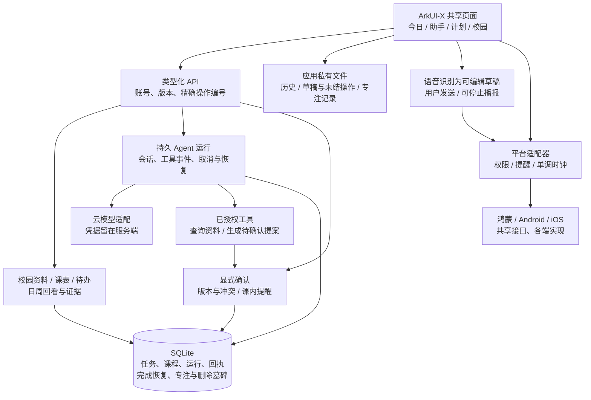

# 行简｜UX01–UX12 交接入口

本文保留 UX12 阶段的历史交接与验证边界。后续 main 功能整合、双主题及实际 Phone 验收以[整合记录](project-documents/branch-integration-2026-10-23.md)为准；下文“本轮”不指后续整合任务。

行简把课程、待办和学习目标放在一起：先看今天，再将想做的事变成可核对的安排。界面继续使用纸白底、墨绿和少量陶土色，原创插图只辅助识别；功能仍有明确的文字入口。

本轮代码与离线验证已完成到 UX11，UX12 整理交付与最终远端核验。**三端编译、安装、真实云模型和系统语音仍待已有设备环境验收**。浏览器画面是根据源码制作的近似演示，不是安装包或原生运行截图。旧第十七阶段部署及真实模型专项没有开展。

## 先看什么

1. 打开 [最终演示入口](previews/ux12-final-demo.html)，先看六组同数据、同390宽度的前后对照，再进入各章交互。旧侧根据第16阶段代码 `c09446bb7b561f1dae1f0967c7932bb7ab4bb8eb` 复现；新侧对应 UX11 `fce0e1d2f46329d1d3552924be890ca0653866d3`。各章使用独立合成资料，不接真实账号。
2. 用 [比赛演示脚本](ux-12-demo-script.md) 走一遍完整情境；[赛事与设备验收表](ux-12-competition-acceptance.md) 将源码、离线实证和待设备结果分开。
3. 接入前读 [接口、存储和回滚说明](ux-12-integration-and-rollback.md)，前后端使用配套版本。保留原包名、数据库和缓存路径；中文名称变化不要求迁移应用身份。
4. 查看 [阶段与分支表](ux-12-stage-index.md)。每阶段都有两仓独立分支和草稿PR，按前一阶段堆叠；最后一条分支包含前面所有阶段。选择配套完整分支验收，避免只取最后的文档提交而漏掉实现。

## 最实用的变化

- **先记下来，再确认安排。** 快速输入解析出时间候选；无法确定的部分如实显示。首次录课可连续添加，导入逐行预览、检查重复和错误，未确认前不保存到服务器。
- **上课时能做的事，由用户逐条决定。** 默认避开课程；某项允许课内完成时，仍提示具体课程和重叠时段。课表变更、改期或恢复后按新版本重新核对，旧确认不能直接沿用。
- **助手的建议有出处、有下一步。** 会话可续聊，工具进度和提案分别展示；确认前看改动，结果未知时先查询原操作，避免反复点击造成重复任务。
- **做完后不打断。** 普通完成留在当前页面，以轻量结果条提供回执入口；恢复未完成仍先预览。专注计时、计时同步和任务完成分开，结束计时不会自动完成任务。
- **回看有记录可查。** 完成事项、待安排和已确认专注时长分别统计，明细可追溯。感受默认仅存本机，主动选择后才放入助手输入框，且不自动发送。

## 当前结构（一页）

模型和工具不会绕过用户确认写入安排。服务端回执是某次操作的结果，不替代当前任务快照；本机文件是离线恢复资料，不是另一套服务端事实。更新、换号、退出和迟到回包均按作用域与版本隔离。

## 验证与接入边界

UX11 最终后端 **943项通过、2项 integration 排除**；客户端 **1119项通过、1项因未安装 JDK 跳过**；静态检查覆盖91个ArkTS/TS文件、21个配置。现有纯Java策略检查的跳过不影响这些实际执行结果，也不能当作原生通过。

[连续旅程](evidence/ux-11-journey.json) 用实际页面非渲染方法、API、控制器、文件逻辑及同一FastAPI/SQLite完成14步、88次HTTP请求；仅模型供应商、系统能力和订阅传输采用明确替身。[UX11检查记录](evidence/ux-11-checks.json) 包含浏览器14项检查、10幅截图、源码摘要和本地观察性加载数据。[可访问性源码核对](evidence/ux-11-accessibility-audit.json) 计算十组文字对比度，最低4.51；不代表三端读屏和大字验收。

原始素材7张，10,701,122字节。[素材记录](project-documents/xingjian-illustrations.md) 保留生成提示和用途，[核验清单](evidence/ux-12-artwork-checks.json) 核对原始文件与当前源码引用。本轮没有复制参考产品图片，也没有用生成图冒充运行画面。

当前发布方式是独立分支+草稿PR，**未合并或覆盖两个仓库的 main**。远端提交、PR状态及两仓四个原有身份文件差异，以最终交付目录中的只读核验记录为准。旧客户端不能保证无损读写新增存储；需要回退时，按配套版本和一致性备份处理，不直接删除新表或本机恢复指针。

## 可直接发给学长

项目现在统一叫“行简”，界面、录课导入、课表冲突重排、课内安排提醒、专注和回看都整理好了，代码分别在两个仓库的独立分支，main没动。前后端离线检查和完整流程已经通过，接入时请使用同一阶段的配套版本。还需要你们用现有环境验证三端安装、真实模型对话、鸿蒙语音以及权限、提醒和本地历史，具体步骤在验收表里。
